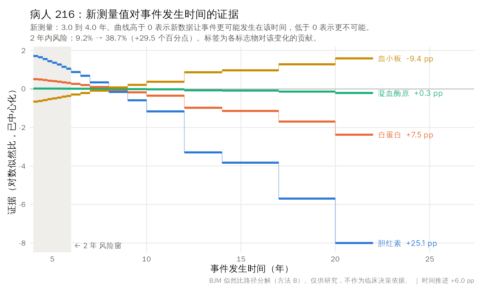

# BJM-mcp：把 BJM 包成 MCP 工具

让医生直接用自然语言问："病人 216 两年风险多少，为什么变了？"
Agent（Claude Desktop / Claude Code / 任何 MCP 客户端）会调用 BJM 回答。

**不改动 BJM 包本身**：R 端只调用 BJM 的公开 API（`predictRisk()`、`survivalSub()`、`longitudinalSub()`）。

## 架构

```
医生提问 ──> LLM agent ──MCP(stdio)──> server.py ──Rscript──> R/backend.R ──> BJM::predictRisk()
                                                                 │
                                                       R/config.R（数据、拟合好的模型、标志物）
```

## 工具

| 工具 | 作用 |
|---|---|
| `model_info` | 数据集、结局、标志物、时间单位、注意事项 |
| `patient_history(patient_id)` | 基线协变量和每次就诊的标志物值 |
| `predict_risk(patient_id, horizon=2, prediction_time=最近一次就诊)` | 动态风险：已知在 prediction_time 时未发生事件，并结合截至该时的标志物历史，算出 horizon 内发生事件的概率 |
| `explain_risk_change(patient_id, from_time=上一次就诊, to_time=最近一次就诊, horizon=2)` | **方法 A**：风险变化 ΔR = 时间推进 + 各标志物新测量的 Shapley 贡献，加总严格等于 ΔR |
| `explain_risk_change_path(...)`（参数同上） | **方法 B**：似然比路径分解。先把新数据对事件时间的 log 似然比拆成各标志物的证据曲线 φ_k(t)，再对证据强度 ε 从 0 到 1 积分 Cov_ε(1_window, φ_k)，得到 ψ_k。同时返回方法 A 的值、证据曲线和数值检查。默认还会返回一张证据曲线图（PNG，`plot=True`，`plot_lang="zh"/"en"`） |

速度（单个病人，4 个标志物）：方法 A 约 5 秒，共 18 次 `predictRisk` 调用；方法 B 在 4 核上约 10 秒，共 16 个子集 × 18 个 horizon 的 `predictRisk` 调用，按子集并行（用 `BJM_CORES` 控制核数）。

方法 B 的实现与 BJM-attribution 的 `path.R` / `psi.R` 相同：用公开 API 在多个 horizon 上算 CDF，拼成分箱后验，所以带有分箱误差（`checks.binning_error_dR_data`）。

## 安装

```bash
# R：BJM（从 GitHub 安装）+ jsonlite
Rscript -e 'remotes::install_github("wenhaoli18/BJM"); install.packages(c("jsonlite", "ragg"))'
# Python ≥ 3.10
pip install -r requirements.txt
# 拟合 pbc3 演示模型（约 5 秒），生成 models/fits_pbc3.rds
Rscript R/fit_pbc3.R
# 自检
python tests/smoke_test.py
```

## 接入客户端

Claude Code：

```bash
claude mcp add bjm -- python /path/to/BJM-mcp/server.py
```

Claude Desktop（`claude_desktop_config.json`）：

```json
{ "mcpServers": { "bjm": { "command": "python", "args": ["/path/to/BJM-mcp/server.py"] } } }
```

可选环境变量：`RSCRIPT`（Rscript 路径）、`BJM_FITS`（模型 .rds 路径）、`BJM_TIMEOUT`（秒）、`BJM_CORES`（方法 B 的并行核数）。

## 示例

> 病人 216 两年风险多少，为什么从第 3 年到第 4 年变了？

`explain_risk_change(patient_id="216", from_time=3, to_time=4)` 返回：

| 组成 | 贡献（百分点） |
|---|---|
| 胆红素 serBilir | +25.0 |
| 血小板 platelets | −8.9 |
| 白蛋白 albumin | +6.9 |
| 时间推进 | +6.0 |
| 凝血酶原 prothrombin | +0.4 |
| **合计** | **9.2% → 38.7%（+29.5）**，闭合误差 3e-17 |

这与 BJM-attribution 中 landmark 3→4 的结果一致。若不指定时间，则默认比较最近两次就诊（3.99 → 5.45 年：38.6% → 57.8%）。

方法 B（`explain_risk_change_path`）的结果：

| 组成 | 方法 B ψ | 方法 A Shapley |
|---|---|---|
| 胆红素 | +25.08 | +25.04 |
| 血小板 | −9.42 | −8.86 |
| 白蛋白 | +7.48 | +6.93 |
| 时间推进 | +5.99 | +5.99 |
| 凝血酶原 | +0.33 | +0.36 |

ψ 的加总与分箱后验下的 ΔR_data 相差 1e-9；分箱误差为 6.5e-5。与 BJM-attribution 中整体计算的 `psi.rds` 相比，血小板、白蛋白、凝血酶原一致，胆红素差 0.04 个百分点（单人计算是 25.08，143 人一起计算是 25.12）。原因是 `predictRisk` 根据当时的 at-risk 人群确定积分上界。

### 证据曲线图

`explain_risk_change_path` 默认把证据曲线画成图，作为图片随结果一起返回，客户端会直接显示给医生：



- 横轴是未来事件发生的时间，灰色区域是风险窗。
- 曲线高于 0 表示新测量值让事件更可能发生在该时间，低于 0 表示更不可能。
- 每条曲线末端标出该标志物对风险变化的贡献（方法 B，百分点）。时间推进的贡献写在图的右下角。
- 以 216 为例：新的胆红素值把事件发生的可能性从远期（10 年以后）挪到了 2 年窗内，所以风险上升 25 个百分点；血小板的作用方向相反。

图中标签默认用中文。系统里找不到中文字体（PingFang、微软雅黑、Noto CJK、文泉驿等）时，会自动改用英文。R 需要在 UTF-8 locale 下运行，server.py 已经替你设置好；如有需要，可以用 `BJM_LOCALE` 修改。

## 换成自己的模型

只需修改 `R/config.R`，包括数据框、id 和时间变量、标志物、`survival_variable_all` 和变换函数、默认 horizon、bandcount，然后用相应的拟合脚本生成 `.rds`。`backend.R` 和 `server.py` 不用改。

## 注意

- 演示模型沿用 vignette 设定：没有做模型选择和校准检查。仅供研究演示，不可用于临床决策。
- 结果中标志物的值是 pbc3 数据集变换后的尺度（serBilir 和 platelets 取了对数）。
- 真实病人数据涉及隐私：MCP server 在本地运行，数据只发给 R 进程；但 LLM 客户端会看到工具返回的内容，部署时要注意这一点。
